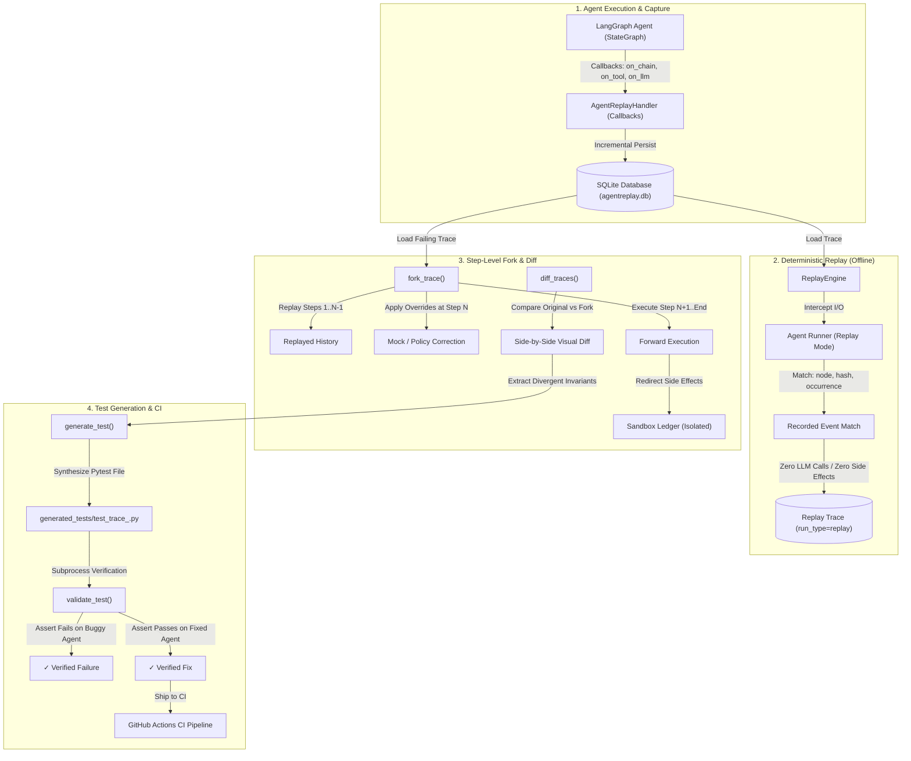

# AgentReplay

> **Failure → Replay → Fork → Regression Test**

AgentReplay is an offline debugger, deterministic replay engine, and regression-testing platform for autonomous LLM agents (LangGraph). When an agent makes a faulty decision in production, AgentReplay lets developers capture the trace, deterministically replay it offline without API costs, fork execution at the exact point of divergence with corrected inputs, and synthesize validated pytest regression tests for CI.

---

## Architecture



---

## Core Capabilities by Phase

| Phase | Milestone | Description |
| :--- | :--- | :--- |
| **Phase 1** | **Deterministic Trace Recording** | Incremental SQLite persistence of `Trace`, `Step`, and `Event` rows. Automatic secret scrubbing (API keys, Authorization headers), PII redaction, and volatile field normalization (timestamps, UUIDs) for stable SHA-256 hashing. |
| **Phase 2** | **Deterministic Replay** | Replays recorded traces offline with zero live LLM or tool calls. Matches events on `(node_name, input_hash, occurrence)`. Enforces strict determinism via `UnrecordedCall` fail-fast exception; leaves production ledgers untouched. |
| **Phase 3** | **Step-Level Fork & Diff** | Branches traces at any arbitrary step index, applies state/tool/prompt overrides, and executes forward while redirecting side effects to an isolated sandbox ledger. Visual side-by-side diff UI highlights divergent steps. |
| **Phase 4** | **Regression Test Synthesis** | Generates standalone pytest regression test files (`test_trace_<id>.py`) asserting on side-effect invariants across boundary values (`days_old=8`, trace's `days_old`, `days_old=30`) plus positive controls (`days_old=7`). Validates via subprocess. |
| **Phase 4.5** | **Real LLM Adapter** | Support for OpenAI-compatible LLM endpoints with Pydantic JSON schema enforcement (`approve`\|`deny`), 1-retry self-correction, HTTP 429 exponential backoff, and strict secret masking. |
| **Phase 5** | **Fault-Injection Benchmark & Investigator** | 40-run primary benchmark across 5 fault injection types plus 16 held-out runs. Generic invariant-based root cause investigator (`ff2cb21dea6d27d7`) achieving 82.5% Top-1 accuracy and 100% Top-3 accuracy. |
| **Phase 6a** | **LangGraph Adapter & Registry** | Zero-instrumentation `AgentReplayHandler` for LangGraph `StateGraph` workflows. Decoupled `register_agent()` system mapping runners and patch targets for clean extensible replay and forking. |
| **Phase 6b** | **Packaging, CI & Read-Only Demo** | Non-root Docker container, docker-compose configuration, read-only demo mode (`AGENTREPLAY_READ_ONLY=1`) locking down mutating endpoints and subprocess execution, and automated offline CI workflow. |

---

## Benchmark Evaluation Results

The evaluation benchmark measures root-cause localization accuracy across 40 verified failing runs (5 fault types, n=8 each) using real LLMs (`openai/gpt-oss-120b`).

> *The table below is automatically extracted from `evals/results.md` by `scripts/copy_benchmark_to_readme.py`:*

<!-- BENCHMARK_TABLE_START -->

| Method | Top-1 Accuracy (95% CI) | Top-3 Accuracy (95% CI) | Mean Tokens | Mean Latency | Parse Failures |
| :--- | :---: | :---: | :---: | :---: | :---: |
| **1. Random Step** | 17.5% [8.7%, 31.9%] | 60.0% [44.6%, 73.7%] | 0 | 0 ms | 0.0% |
| **2. Always Decision Step (llm_decide)** | 20.0% [10.5%, 34.8%] | 80.0% [65.2%, 89.5%] | 0 | 0 ms | 0.0% |
| **3. Deterministic Diff vs Clean Reference** | 67.5% [52.0%, 79.9%] | 100.0% [91.2%, 100.0%] | 0 | 0 ms | 0.0% |
| *4a. LLM Investigator (leaky prompt - point 4 hints)* | *80.0% [65.2%, 89.5%]* | *92.5% [80.1%, 97.4%]* | 2707.8 | 18280.6 ms | 0.0% |
| **4. LLM Investigator (frozen prompt: `ff2cb21dea6d27d7`)** | **82.5% [68.1%, 91.3%]** | 100.0% [91.2%, 100.0%] | 2677.7 | 181233.9 ms | 0.0% |

<!-- BENCHMARK_TABLE_END -->

---

## Quickstart

### 1. Local Setup

Clone the repository and install with development dependencies:

```bash
git clone https://github.com/your-org/TraceForge.git
cd TraceForge
pip install -e ".[dev]"
```

Run tests and linting (100% offline, stub LLM):

```bash
# Run test suite
pytest -q

# Run code style and lint checks
ruff check .
```

Seed the demo database with verified runs:

```bash
python scripts/seed_demo.py
```

Launch the interactive dashboard:

```bash
uvicorn agentreplay.api:app --reload --port 8000
```
Visit `http://localhost:8000` to inspect traces, browse step diffs, and view generated regression tests.

---

### 2. Docker Setup

Build and run using Docker:

```bash
# Build the container image
docker build -t agentreplay:latest .

# Run with local database volume mounted
docker run -p 8000:8000 -v $(pwd)/agentreplay.db:/app/agentreplay.db agentreplay:latest
```

Or start with Docker Compose:

```bash
docker compose up -d
```

### 3. Read-Only Demo Mode

To run a public or shared demo instance where mutating operations and subprocesses are completely locked down:

```bash
export AGENTREPLAY_READ_ONLY=1
uvicorn agentreplay.api:app --host 0.0.0.0 --port 8000
```

When `AGENTREPLAY_READ_ONLY=1`:
- All mutating endpoints (`POST /traces`, `POST /traces/{id}/fork`, `POST /tests/generate`) return `403 Forbidden`.
- No subprocesses can be spawned through any route.
- Dashboard and trace inspection GET views continue to function seamlessly.

---

## 5-Minute Demo Flow

Experience the complete **Failure → Replay → Fork → Regression Test** cycle in 5 minutes:

### Step 1: Run Agent with a Fault
Run the demo agent with an injected stale policy (allowing refunds up to 30 days instead of 7). An order 12 days old is wrongly approved:
```bash
python examples/record_demo.py
```
*Output: Trace recorded in SQLite. Real ledger records an unintended $79.50 refund.*

### Step 2: Replay Offline (Zero Live Calls)
Replay the captured trace. The engine patches all external tools and LLMs:
```bash
python examples/replay_demo.py
```
*Output: 100% replay fidelity confirmed. Exactly 0 live network calls made. Real ledger remains untouched.*

### Step 3: Fork at Step 3 with a Fix
Branch the execution at Step 3 (`read_refund_policy`), injecting the valid 7-day policy:
```bash
python examples/fork_demo.py
```
*Output: The agent branches at step 3, re-evaluates step 4, and changes its decision from APPROVE to DENY. Side effects write strictly to an isolated sandbox ledger.*

### Step 4: Synthesize a Regression Test
Generate a standalone pytest regression test directly from the trace divergence:
```bash
python examples/testgen_demo.py
```
*Output: Generated `generated_tests/test_trace_<id>.py`. Validated via subprocess: fails against the buggy agent, passes against the fixed agent.*

### Step 5: Run Generated Tests in CI
Run the synthesized regression test as part of standard test pipelines:
```bash
pytest generated_tests/ -v
```

---

## Using AgentReplay with Your Own Agent

### 1. Recording is Generic
Any synchronous LangGraph `StateGraph` can be traced without modifying the agent's internal business logic using `AgentReplayHandler`:

```python
from agentreplay.sdk import record_trace
from agentreplay.integrations.langgraph import AgentReplayHandler

with record_trace(agent_name="my_agent", description="My Agent Execution") as rec:
    result = graph.invoke(
        {"input": "user query"},
        config={"callbacks": [AgentReplayHandler(rec)]},
    )
    rec.finalize(final_output=result)
```

**Callback Provenance:**
- `Step` rows are created and closed at the graph node execution level via `on_chain_start` / `on_chain_end`.
- `Event` rows are strictly created by `@tool` callbacks (`on_tool_start` / `on_tool_end`) and LLM callbacks (`on_llm_start` / `on_llm_end` or `on_chat_model_start` / `on_chat_model_end`).
- `on_chain_*` callbacks never produce `Event` rows.

### 2. Replay & Forking Require Registration
Deterministic plain-software replay and sandbox forking require intercepting external I/O and side-effecting functions. You must explicitly register your agent runners and patch targets:

```python
from agentreplay import register_agent

register_agent(
    name="my_agent",
    runner=run_my_agent,
    runner_from_step=run_my_agent_from_step,
    patch_targets=[
        "my_package.tools.fetch_customer",
        "my_package.tools.execute_transaction",
        "my_package.llm.get_llm",
    ],
)
```
If an unregistered agent is passed to `fork_trace` or `replay_agent`, AgentReplay raises an `UnknownAgentError` explaining how to register it.

---

## Known Limitations

AgentReplay is designed with strict engineering boundaries. To maintain transparency, here is what it **cannot** do:

1. **Does Not Support Arbitrary Agents Automatically:**  
   AgentReplay does **not** claim to work with any arbitrary agent out of the box. Replay and forking require explicit registration of external side-effect points (`register_agent`). Unregistered side-effects will either leak to production or fail.
2. **Domain-Specific Regression Test Synthesis:**  
   The regression test generator (`agentreplay/test_gen.py`) is currently a domain-specific template tailored to refund workflows and boundary policies (`days_old`). Generalized semantic test generation for arbitrary domain schemas is not yet supported.
3. **Synchronous Execution Only:**  
   LangGraph `graph.ainvoke()` and asynchronous execution loops (`asyncio`) are not yet supported. The SDK and callback handler currently use synchronous database sessions.
4. **No Streaming Support:**  
   Token-by-token or chunk-by-chunk streaming (`graph.stream()`, `graph.astream()`) is not captured. Tracing records completed node invocations and completed tool calls.
5. **No Parallel Branch Replay:**  
   Graphs with asynchronous concurrent branches that execute out-of-order cannot be deterministically replayed.
6. **Non-Standard Date / Time Strings:**  
   The volatile field stripper normalizes standard ISO 8601 timestamps and UUIDs. Localized date strings (e.g. `19/11/2026`) or natural language timestamps (e.g. "3 hours ago") embedded in prompt prose are not automatically stripped.
7. **Development Auto-Migration:**  
   SQLite auto-migration in `agentreplay/db.py` is a developer convenience. Production deployments must manage schema migrations using versioned Alembic scripts.
